<p align="center">
  
</p>

<h1 align="center">tidings</h1>

<p align="center">A macOS-style Notification Centre for Hyprland, in Rust.</p>

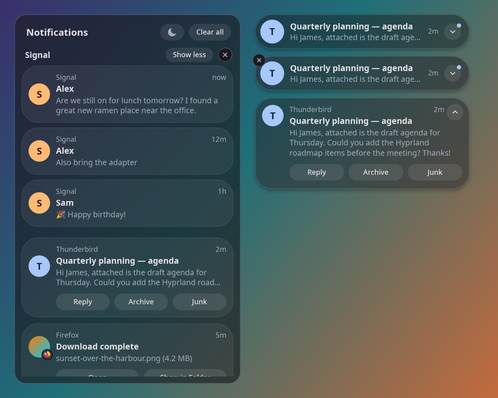

- **Notification daemon.** It implements `org.freedesktop.Notifications` (actions, body markup, images, persistence), so it replaces swaync, mako or dunst.
- **Toasts** in the top-right corner: compact one-line glass pills. Hovering pauses expiry; the expand button grows a toast into the full card (long body, action buttons), and an expanded toast stays until collapsed or dismissed.
- **Inline replies.** Notifications that offer a reply (Telegram, Chrome web notifications and other apps using KDE's `inline-reply` extension) get a Reply button that opens a text field right in the toast or the panel. Enter sends; Esc discards. Web notifications also show their site after the app name.
- **Notification Centre panel.** A full-height glass panel on the right edge, with notifications grouped by app into stacks, Do Not Disturb, Clear all and per-group clear.
- **Trackpad gesture.** Put two fingers on the right edge of the trackpad and swipe left: the panel **follows your fingers**. Let go past halfway, or flick, and it opens; otherwise it springs back. Two fingers swiping right close it.
- **Themes.** Nine built in, from frosted glass to a terminal look, and every shape, colour and font setting can be changed.

| Toast | Expanded | Replying |
|---|---|---|
| 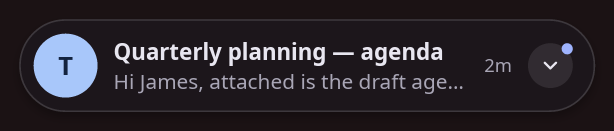 | 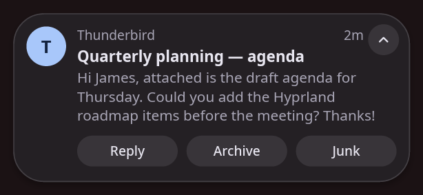 | 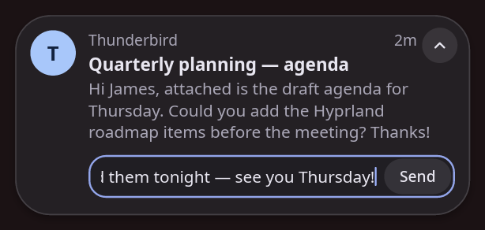 |

<sub>Rendered by tidings' own drawing code. On screen, Hyprland also blurs what is behind the glass.</sub>

One binary. No GTK, no Qt, no runtime scripting.

## Contents

- [Requirements](#requirements)
- [Install](#install): from a release, or from source
- [Set up](#set-up): replace your old daemon, start with Hyprland, blur, the trackpad gesture
- [Using it](#using-it)
- [Configuration](#configuration), [themes](#themes) and [colours](#colours)
- [Updating and uninstalling](#updating-and-uninstalling)
- [Troubleshooting](#troubleshooting)
- [Development](#development)

## Requirements

- **A Wayland compositor** with `wlr-layer-shell`, `fractional-scale-v1`, `viewporter` and `cursor-shape-v1`. tidings is made for Hyprland, and runs on others with those protocols (sway, for one), without the blur.
- **`libxkbcommon`** and at least one font. Desktop systems have both already.
- **A D-Bus session bus**, which every desktop session has.

## Install

### From a release

Each [release](https://github.com/ThatCatDev/tidings/releases) has a prebuilt x86-64 Linux build:

```sh
tar xzf tidings-v*-x86_64-linux.tar.gz
cd tidings-v*-x86_64-linux
./install.sh
```

### From source

You need Rust 1.89 or newer (from [rustup](https://rustup.rs) if your distribution's is older), a C toolchain and the `libxkbcommon` and Wayland development files:

```sh
# Arch
sudo pacman -S --needed base-devel libxkbcommon wayland
# Debian / Ubuntu
sudo apt install build-essential libxkbcommon-dev libwayland-dev
# Fedora
sudo dnf install gcc libxkbcommon-devel wayland-devel
```

Then:

```sh
git clone https://github.com/ThatCatDev/tidings.git
cd tidings
./install.sh
```

### What `install.sh` does

It installs for your user only, with no root needed, and is safe to run again:

| file | what it is |
|---|---|
| `~/.local/bin/tidings` | the daemon, and `tidings ctl` to control it |
| `~/.local/bin/tidings-noctalia-colors` | turns a [Noctalia](https://noctalia.dev) palette into tidings' colours (optional) |
| `~/.local/share/dbus-1/services/dev.thatcat.tidings.service` | lets D-Bus start tidings if a notification arrives before your session has |

Set `PREFIX` to install somewhere other than `~/.local`. Make sure `~/.local/bin` is on your `PATH`.

## Set up

### 1. Stop your old notification daemon

Only one program can be the notification daemon. tidings refuses to start while another one is running; it never takes over. To see which one is running now:

```sh
busctl --user status org.freedesktop.Notifications | grep -E '^(Comm|CommandLine)='
```

Remove it from your autostart and stop it: `pkill swaync`, `pkill mako` or `pkill dunst`, for example. Shells with their own notifications, such as Noctalia, need that turned off in their settings (for Noctalia, `[notification] enable_daemon = false`).

### 2. Start tidings with Hyprland

In your Hyprland config (Lua):

```lua
-- start with the session
hl.exec_cmd("tidings")

-- open and close the panel from the keyboard
hl.bind("SUPER + A", hl.dsp.exec_cmd("tidings ctl toggle"))
```

With `hyprland.conf` it is `exec-once = tidings` and `bind = SUPER, A, exec, tidings ctl toggle`.

To start it now, without logging out, run `tidings &` (or `setsid -f tidings` so it outlives the terminal).

On sway: `exec tidings` and `bindsym $mod+a exec tidings ctl toggle`.

### 3. Blur behind the glass

Hyprland draws the blur, so it needs a layer rule for each of tidings' surfaces:

```lua
hl.layer_rule({ name = "tidings-panel", match = { namespace = "^tidings-panel$" },
                blur = true, ignore_alpha = 0.3, xray = false })
hl.layer_rule({ name = "tidings-toast", match = { namespace = "^tidings-toast$" },
                blur = true, ignore_alpha = 0.4, xray = false })
```

For `hyprland.conf`, write the same rules in its layer rule syntax (see the [Hyprland wiki](https://wiki.hypr.land/configuring/core/rules/layer-rules/)): blur on, `ignore_alpha` 0.3 for the `tidings-panel` namespace and 0.4 for `tidings-toast`.

`ignore_alpha` matters. Hyprland only blurs pixels more opaque than it, so it must sit below the glass (the `clear` theme's panel is 0.4 opaque) and, for toasts, above their soft shadow (at most 0.28). Otherwise the shadow blurs into a grey halo.

### 4. The trackpad gesture (optional)

The swipe reads the trackpad directly (read-only; it never takes the device from your desktop). Allow your user to read the built-in trackpad, and nothing else, with one udev rule:

```sh
echo 'SUBSYSTEM=="input", KERNEL=="event*", ENV{ID_INPUT_TOUCHPAD}=="1", ENV{ID_INPUT_TOUCHPAD_INTEGRATION}=="internal", TAG+="uaccess"' \
  | sudo tee /etc/udev/rules.d/70-touchpad-uaccess.rules
sudo udevadm control --reload && sudo udevadm trigger --subsystem-match=input --action=change
```

Restart tidings afterwards. Without the rule everything else works, just not the swipe. Turn the gesture off entirely with `[gestures] enabled = false` in the config.

### 5. Try it

```sh
notify-send "Hello" "from tidings"
notify-send -A open=Open -A later=Later "With buttons" "Expand the toast to see them"   # waits for a click
tidings ctl toggle
```

### A button in your bar (optional)

Any bar that can run a command on click can open the panel with `tidings ctl toggle`. For Noctalia, add `"tidings"` to a bar section and:

```toml
[widget.tidings]
type = "custom_button"
glyph = "bell"
tooltip = "Notification Centre"

[widget.tidings.actions]
left = "exec tidings ctl toggle"
right = "exec tidings ctl dnd toggle"
```

## Using it

- **Toasts** appear top right. Hover to keep one on screen, click to open the app, ⌄ to expand it and see its buttons, × to dismiss.
- **The panel** holds everything you haven't dismissed: swipe in from the trackpad's right edge, press your key binding, or run `tidings ctl toggle`. Click a stack to expand it. Esc or a click outside closes it.
- **Replying:** click **Reply** on an expanded toast or in the panel, type, and press Enter. Ctrl+V pastes; Esc throws the draft away.
  - Chrome only offers replies for web notifications with `chrome://flags/#enable-experimental-web-platform-features` turned on, and only after a restart once tidings is running (it checks what the notification daemon supports when it starts).
- **Do Not Disturb** (the moon in the panel, or `tidings ctl dnd`) keeps notifications in the panel without showing toasts, except critical ones (a low battery, say).

From the command line:

```
tidings ctl toggle | open | close     the panel
tidings ctl clear-all                  dismiss everything
tidings ctl count                      how many notifications there are
tidings ctl is-open                    whether the panel is open
tidings ctl dnd [on|off|toggle]        Do Not Disturb (no argument: show it)
```

Exit codes: 0 ok, 1 error, 2 tidings is not running.

## Configuration

Settings live in `~/.config/tidings/config.toml` (override the path with `TIDINGS_CONFIG`). Every setting is optional. See [`config.example.toml`](config.example.toml) for the full list with defaults:

- **Toasts:** timeouts for each urgency and the number shown at once.
- **Gestures:** on or off, edge zone, swipe distance and flick speed.
- **Animation:** on or off, and speed.
- **Theme:** which theme, overrides of any of its settings, and the colours file path.

```sh
mkdir -p ~/.config/tidings
tidings config default > ~/.config/tidings/config.toml   # start from the template
tidings config check                                      # validate it
tidings config path                                       # where tidings looks
```

The file is type-checked. Unknown keys, wrong types, malformed durations (`"4s"`, `"250ms"`) and out-of-range numbers are errors, reported as `file:line:column: key: message`. If the file is invalid, the daemon logs the errors and starts with the defaults. Changes apply when tidings restarts.

### Themes

A theme sets the look: corner radius, border width, colour and opacity, transparency, blur, shadow, font, text size and line height. Nine are built in:

| theme | look |
|---|---|
| `glass` (default) | Frosted, translucent and pill-shaped, like the macOS Notification Centre. |
| `frosted` | Thicker, milkier glass: more opaque, softer rims, rounder corners. |
| `clear` | Barely-there glass held together by crisp light rims. |
| `solid` | Opaque surfaces in your Noctalia colours, rounded but not pills. |
| `flat` | Minimal: opaque, small corners, hairline borders and no shadow. |
| `paper` | Light, warm off-white paper with a terracotta accent and soft shadows. |
| `nord` | Glass in the Nord palette: polar night surfaces, frost-blue accents. |
| `mocha` | Catppuccin Mocha: deep base, mauve accents, soft lavender rims. |
| `terminal` | Gruvbox and a monospace font: square corners, bright yellow borders, no shadow. |

| | | |
|---|---|---|
| <br>`glass` | 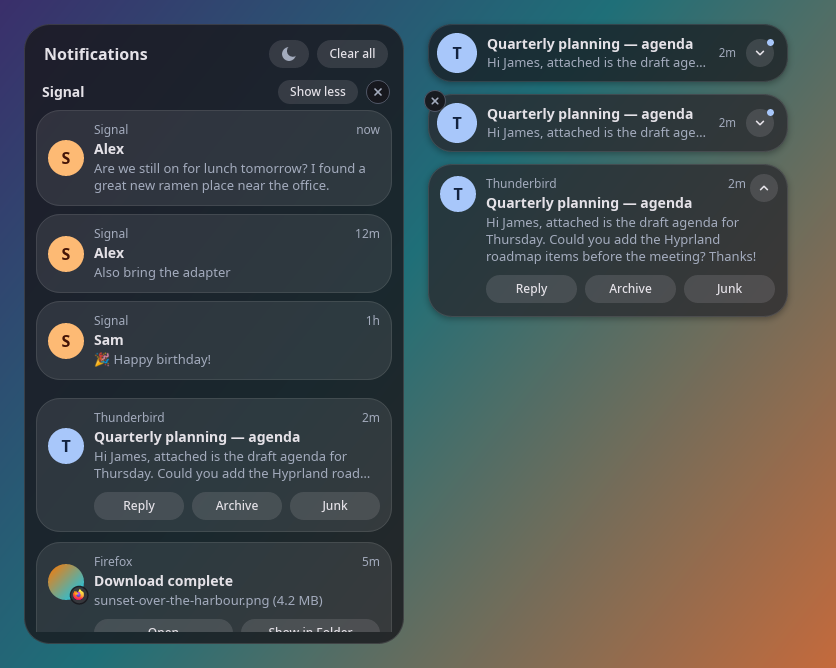<br>`frosted` | 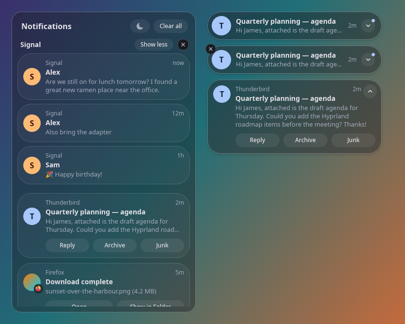<br>`clear` |
| 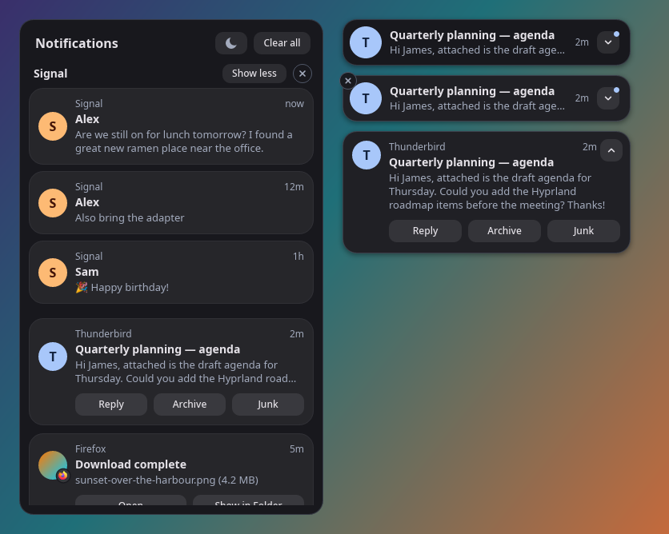<br>`solid` | 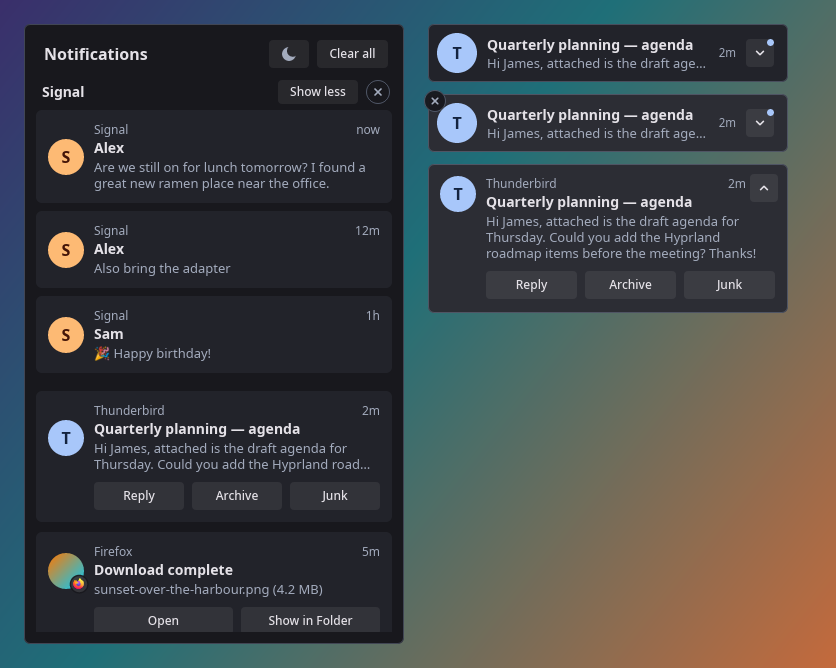<br>`flat` | 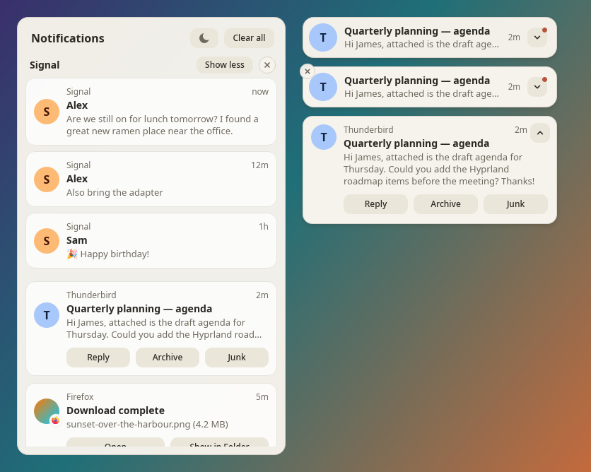<br>`paper` |
| 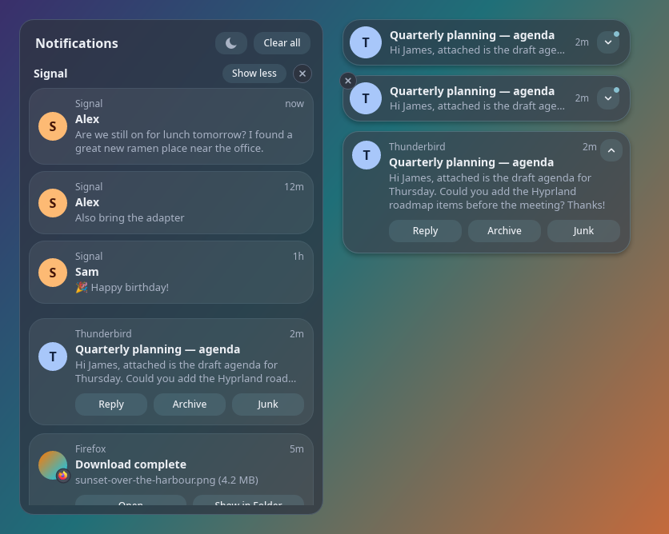<br>`nord` | 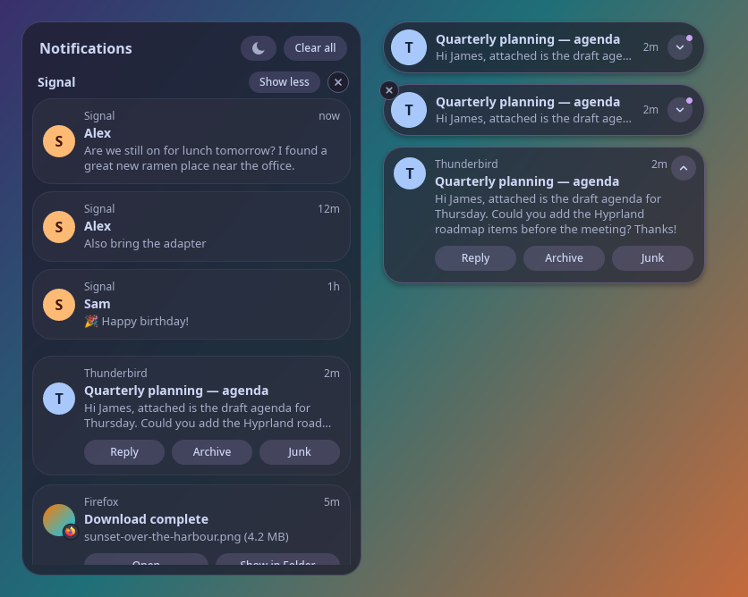<br>`mocha` | 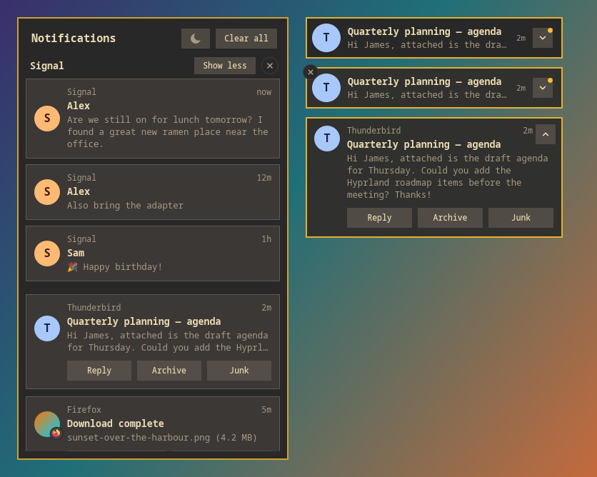<br>`terminal` |

Pick one in `config.toml`, and change any of its settings right there:

```toml
[theme]
name = "nord"

[theme.panel]
radius = 12
border_width = 2

[theme.font]
line_height = 1.4
```

To make your own, put a file in `~/.config/tidings/themes/` (`tidings theme path`). A file with a built-in's name replaces it. [`themes/glass.toml`](themes/glass.toml) documents every setting at its default; a theme only needs the keys it changes.

```sh
tidings theme list                        # * marks the one in use
mkdir -p ~/.config/tidings/themes
tidings theme show glass > ~/.config/tidings/themes/mine.toml
tidings theme check mine                  # or a path to a .toml file
```

Theme files are checked like the config. A broken theme is logged and `glass` is used instead.

Colours are `#rrggbb` or a slot of the colour scheme (`surface`, `surface_variant`, `on_surface`, `on_surface_variant`, `primary`, `on_primary`, `error`, `outline`, or `tint`), and slots follow Noctalia. A theme's `[palette]` replaces colours from `colors.json` outright.

Blur is drawn by Hyprland. With `blur = true` the surfaces use the `tidings-panel` and `tidings-toast` layer namespaces, and with `blur = false` they use `tidings-panel-noblur` and `tidings-toast-noblur`. Hyprland skips pixels below a layer rule's `ignore_alpha`, so keep blurred opacities above it and the toast shadow below it.

### Colours

The colours come from `~/.config/tidings/colors.json`. Override the path with `TIDINGS_COLORS` or the config's `theme.colors`. tidings watches the file and applies changes live. With [Noctalia](https://noctalia.dev), have its `colors_changed` hook run `tidings-noctalia-colors`, and tidings follows your wallpaper palette.

## Updating and uninstalling

To update, install again the same way (a newer release, or `git pull && ./install.sh`), then restart tidings:

```sh
pkill -x tidings; setsid -f tidings
```

To uninstall, run `./install.sh --uninstall`. Your settings in `~/.config/tidings` are left in place; delete that folder too if you want. Then set up your previous notification daemon again.

## Troubleshooting

Run tidings in a terminal with more logging to see what it is doing:

```sh
pkill -x tidings; TIDINGS_LOG=debug tidings
```

- **"org.freedesktop.Notifications is already owned by another notification daemon"**: another daemon is running. See [Set up, step 1](#1-stop-your-old-notification-daemon).
- **No blur**: check the layer rules ([step 3](#3-blur-behind-the-glass)) and that the theme has `blur = true`. Screenshots never show Hyprland's blur, so look at the screen itself.
- **The swipe does nothing**: the log says whether a trackpad was found. Without the udev rule ([step 4](#4-the-trackpad-gesture-optional)) it can't read one.
- **Settings don't apply**: run `tidings config check` (and `tidings theme check`), then restart tidings. Settings are read at startup; only the colours file is watched live.
- **Chrome shows Reply as a plain button**: see the Chrome note under [Using it](#using-it).

## Development

```
crates/core      domain model, store, policies, view building   (pure, no I/O)
crates/gesture   evdev multitouch decoder + gesture recogniser   (pure) + device reader
crates/ui        Wayland layer-shell UI: sctk + tiny-skia + cosmic-text
crates/tidings   the binary: D-Bus server (zbus), app actor, IPC socket, CLI
```

- **A single actor owns all state.** D-Bus calls, gesture events, UI interactions, IPC requests and timers are messages on one channel.
- **The UI is a passive renderer.** It receives a `ViewModel` snapshot and reports interactions back as events.
- **I/O sits behind traits.** The clock, input device, UI handle and signal sink are all traits, so everything is testable without hardware, a compositor or the session bus.

See [DESIGN.md](DESIGN.md) for the full spec.

```sh
cargo fmt --all -- --check
cargo clippy --workspace --all-targets -- -D warnings   # clippy::pedantic
cargo test --workspace          # unit + integration (private dbus-daemon, never the session bus)
                                # (the UI end-to-end tests need sway, wtype, wl-clipboard and grim;
                                #  they run a private headless sway and skip without it)
sh tests/colors.sh              # the Noctalia colours script
scripts/coverage.sh             # coverage report + the 80%-per-file gate (needs cargo-llvm-cov, jq)
cargo run -p tidings-ui --example demo --release        # UI demo on the live compositor
cargo run -p tidings-ui --example demo --release -- themes DIR [SCALE]   # render every theme to PNGs (the README's gallery: SCALE 1)
cargo run -p tidings-ui --example demo --release -- states DIR  # a toast's states (collapsed, hover, expanded, replying)
cargo run -p tidings --example web_notify     # test page for Chrome web notifications (replies, buttons) on localhost:8317
```

### Releases

Every pull request gets a comment with its test coverage, compared with the branch it targets (the `coverage` workflow; it updates the same comment on each push). The check fails if any source file drops under 80% of lines covered; the aim is 85% or more everywhere.

Releases are fully automatic (semantic release via [cocogitto](https://docs.cocogitto.io)). Commit messages must follow [Conventional Commits](https://www.conventionalcommits.org), and CI rejects any that don't.

| commit | release |
|---|---|
| `fix: ...`, `perf: ...` | patch (0.1.0 → 0.1.1) |
| `feat: ...` | minor (0.1.0 → 0.2.0) |
| `feat!: ...` or a `BREAKING CHANGE:` footer | major |
| `docs:`, `refactor:`, `test:`, `ci:`, `build:`, `chore:`, `style:` | no release |

After CI passes on `main`, the release workflow does the rest:
1. Bumps the workspace version in `Cargo.toml` and `Cargo.lock`.
2. Updates `CHANGELOG.md`.
3. Commits `chore(version): vX.Y.Z` and tags it.
4. Publishes a GitHub release with the changelog and a `tidings-vX.Y.Z-x86_64-linux.tar.gz` binary.

Locally, `cog check` validates messages and `cog bump --auto --dry-run` shows the next version.

## License

MIT
